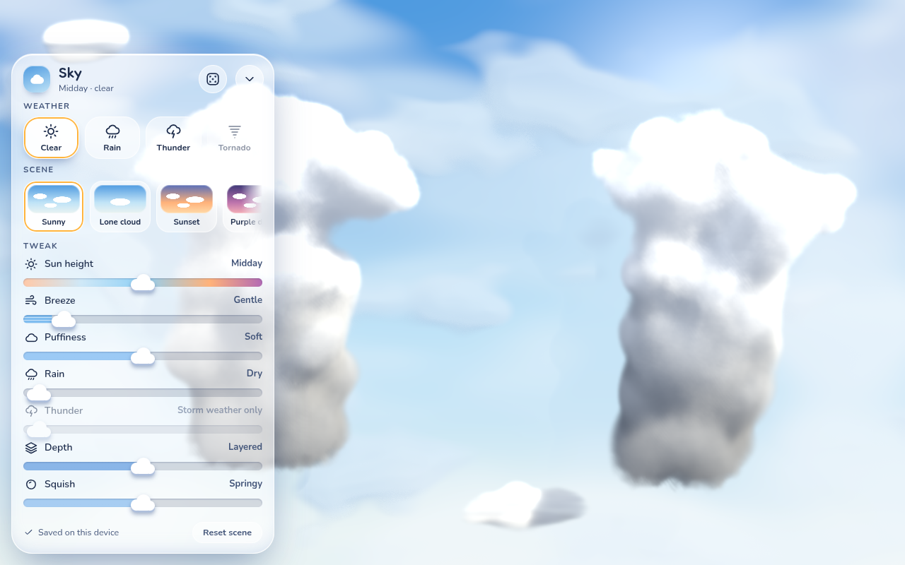
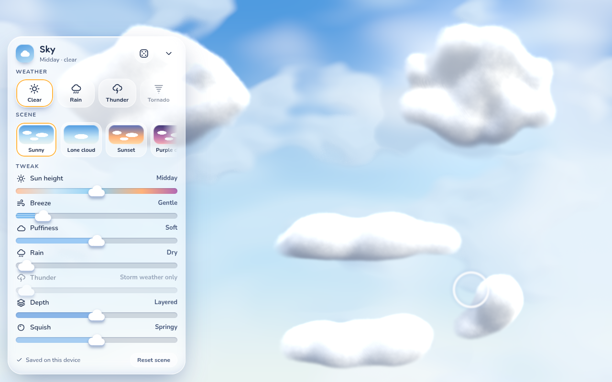

# Cloudy

[](https://github.com/RafaelBroseghini/cloudy/actions/workflows/ci.yml)
[](https://github.com/RafaelBroseghini/cloudy/actions/workflows/pages.yml)
[](https://rafaelbroseghini.github.io/cloudy/)
[](LICENSE)


-e05d44)

A 2.5D browser toy. Push a cursor through springy clouds: they resist more where they are denser, dent, spring back, split into pieces that persist, and re-merge when the pieces touch. Rain and thunder weather change how the clouds behave.

**Play it:** https://rafaelbroseghini.github.io/cloudy/





## Highlights

- **Volumetric clouds.** Each blob is a 3D ellipsoid, raymarched through per-tile lists with light marching. The physics stays 2D on the CPU.
- **Real springs.** Blob bodies and spring joints run on Box2D v3 (WebAssembly). Splits persist; pieces always re-merge on touch.
- **Weather.** Clear, rain and thunder, each a typed parameter set blended over time. Lightning flashes and plays thunder in sync, and never changes how the clouds respond to you.
- **Sky panel.** Preset scenes, a few sliders and a randomizer, saved on the device. No accounts, no sharing.
- **Runs everywhere.** WebGPU where available, WebGL2 otherwise, with the same game on both. Mouse, trackpad and touch.

## Getting started

Requires Node 24 (the version CI uses).

```bash
npm ci
npm run dev        # http://127.0.0.1:43200 (add ?backend=webgl to force WebGL2)
```

| Command | What it does |
| --- | --- |
| `npm run dev` | Vite dev server |
| `npm run typecheck` | `tsc --noEmit`, strict |
| `npm run lint` | oxlint |
| `npm test` | Vitest and fast-check unit and property tests |
| `npm run build` | Typecheck, then production build |
| `npm run build:pages` | Build with the `/cloudy/` base the Pages deploy uses |
| `npm run preview:pages` | Serve that build at http://127.0.0.1:43202/cloudy/ |
| `npm run verify` | Drive the built game in a real browser on WebGPU, WebGL2 and a phone viewport; screenshots go to `artifacts/verify/` |

`npm run verify` needs a browser and a visible window for WebGPU. See `.agents/skills/verify`.

## How it is built

- **CPU owns gameplay, GPU only draws.** The simulation (`src/sim`) is pure TypeScript and runs at a fixed 60 Hz step, so the same inputs give the same result at any display rate. Nothing is read back from the GPU.
- **Rendering** uses three.js `WebGPURenderer` with TSL node materials. `src/render` never changes simulation state.
- **Deploys** from `main` to GitHub Pages after CI passes (`.github/workflows`).

## Documentation

- [`docs/PLAN.md`](docs/PLAN.md): target design, milestones and invariants
- [`docs/SIM.md`](docs/SIM.md): how the simulation maps onto Box2D, and where it departs from the plan
- [`docs/RENDER.md`](docs/RENDER.md): render passes, raymarched volumes, bloom and grading, quality tiers
- [`docs/PARAMS.md`](docs/PARAMS.md): parameter layers, weather, strikes and the live dev panel (`` ` `` or `?dev`)
- [`docs/SETTINGS.md`](docs/SETTINGS.md): player sliders, scenes and saved settings
- [`docs/UI.md`](docs/UI.md): the Sky panel, its tokens, accessibility and reduced motion
- [`docs/HARNESS.md`](docs/HARNESS.md): driving the game through `window.__GAME__` in tests and verification

## Contributing

Commits follow conventional commits (`feat(scope):`, `fix(scope):`, `test:`, `docs:`, `chore:`). Before you open a pull request, run `npm run typecheck`, `npm run lint`, `npm test` and `npm run build`, and `npm run verify` for anything that renders.

Thunder audio clips in `public/audio/` must be CC0 or public domain.

## License

Released under the [MIT License](LICENSE).
